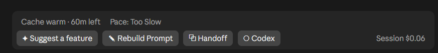

# Session Bar for Claude Code

A Claude Code mod that adds a bar right above the prompt box in the Claude desktop app's Code tab.

I've been using this mod bar, and it's working really well.



## What's on the bar

| Part | What it does |
| --- | --- |
| **✦ Suggest a feature** | Reads your last few messages and puts one idea for what to build next in the prompt box. |
| **✎ Rebuild Prompt** | Rewrites the rough draft in your prompt box into a clear, structured prompt, keeping everything you asked for. |
| **⧉ Handoff** | Summarizes the whole session (what you asked, what Claude did, where things stand and the next steps) and copies it to your clipboard, so you can paste it into a new chat. |
| **○ Codex** | A toggle. While it's on, Claude hands each prompt you send to the [OpenAI Codex CLI](https://github.com/openai/codex) instead of doing the work itself. Claude checks the result, re-prompts Codex with feedback if it's wrong, and reports back. Follow-up prompts continue the same Codex session. Off by default in every new session. |
| **⇪ Commit N files** | Shows when the session folder has uncommitted git changes. It writes a commit message and commits everything with your own git identity. |
| **Cache warm · Nm left** | Minutes left before the prompt cache expires. Hover to see roughly what restarting after it expires would cost. |
| **Too Fast / Good Speed / Too Slow** | Whether your 5-hour usage limit is on track to run out before it resets. |
| **Subagents** | How many subagents are running or have finished. |
| **Session $X.XX** | What this session has cost so far. |

Suggest, Rebuild Prompt, Handoff and the commit message each make one small call to Claude Haiku 5.5 (low effort), which counts toward your usage.

Codex mode needs the Codex CLI installed and signed in (`codex login`). Each Codex-mode prompt uses your Codex usage, plus a little Claude usage for checking and reporting. Codex runs with `--sandbox workspace-write` in the session folder, so it can edit files there but nothing outside it.

In the terminal (CLI), the mod shows the session cost next to the mode labels in the footer. The bar is drawn only in the desktop app.

## Install

From a shell:

```bash
claude plugin install session-cost --marketplace MaanasEgamamidi/claude-mods-session-bar
```

Or at the prompt of a terminal Claude Code session:

```
/plugin install session-cost --marketplace MaanasEgamamidi/claude-mods-session-bar
```

Answer `y` to add the marketplace, then press Enter to pick the user scope.

In the desktop app: click **+** next to the prompt box, then **Plugins** > **Add marketplace**, enter `MaanasEgamamidi/claude-mods-session-bar`, then **Add plugin**.

The bar appears in the next session you start.

## Install from a clone

```bash
git clone https://github.com/MaanasEgamamidi/claude-mods-session-bar
claude plugin install session-cost --marketplace ./claude-mods-session-bar
```

To try it in one session without installing: `claude --plugin-dir ./claude-mods-session-bar`.

## Files

- `hooks/register.tsx`: the mod
- `hooks/cost.test.tsx`: tests (`claude plugin test .`)
- `types/index.d.ts`: the state the mod keeps
- `.claude-plugin/plugin.json` and `.claude-plugin/marketplace.json`: what makes it installable
